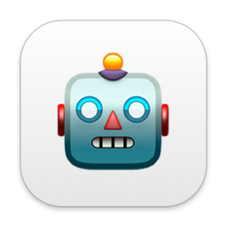

#  ClaudePulse

Menu bar app that shows the state of your running Claude Code sessions, so you know when one needs input or has finished. Click a session to jump to its Ghostty terminal.

## Installation

ClaudePulse is ad-hoc signed (not notarized). On first launch, right-click the app in Finder and choose "Open", or run:

```bash
xattr -dr com.apple.quarantine /Applications/ClaudePulse.app
```

Then open Preferences and click **Install** under Claude Code hooks, and restart running sessions.

## How it works

- Hooks: Preferences adds entries to `~/.claude/settings.json` that run `ClaudePulse --hook <Event>`. Each event updates one file per session in `~/Library/Application Support/ClaudePulse/sessions/`.
- Menu bar: `◌` idle, `●` working, `◐` waiting for a subagent, a green `✓` finished, an orange `!` needs input. The most urgent session wins; clicking a finished session marks it seen.
- Click: focuses the Ghostty terminal whose working directory matches the session (first match when several do), otherwise just activates Ghostty. macOS asks once to allow Automation for Ghostty.
- Notifications: optional, off by default.

## Development

- Build + install locally: `./rebuild.sh` (needs [menubar-kit](https://github.com/PhilRoli/menubar-kit) cloned next to this repo, or `MENUBAR_KIT` set).
- Tests: `swift test`. Lint: `swiftlint --strict`.
- Release: push a tag `vX.Y.Z`; the Release workflow builds the app and updates the cask in `PhilRoli/homebrew-tap`.
- Regenerate the icon: `../menubar-kit/scripts/make-icon.sh 🤖`.

## License

MIT
